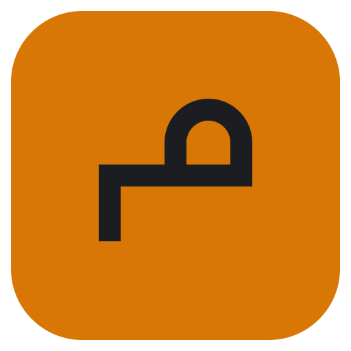
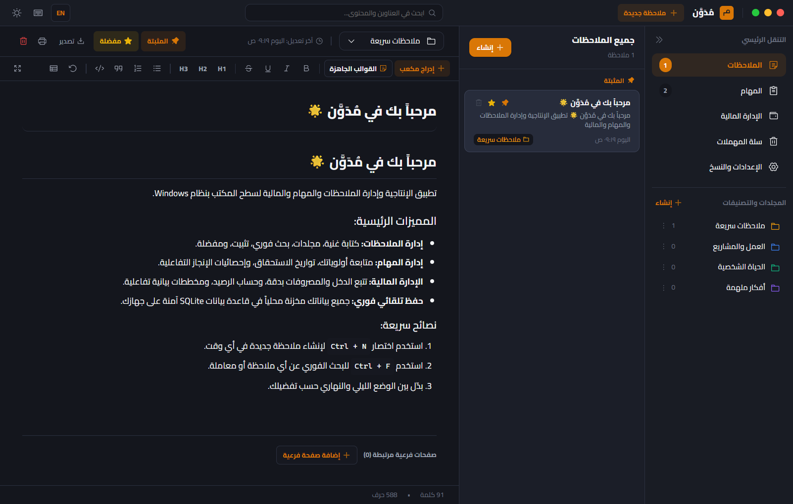
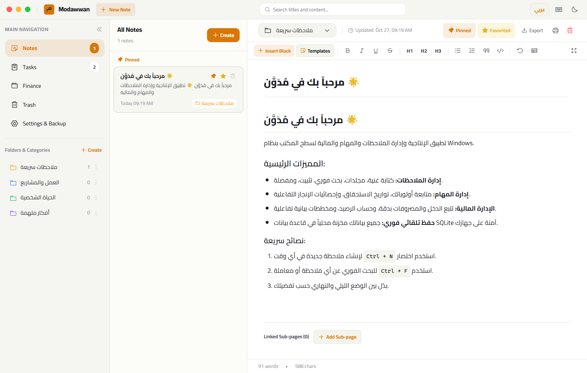
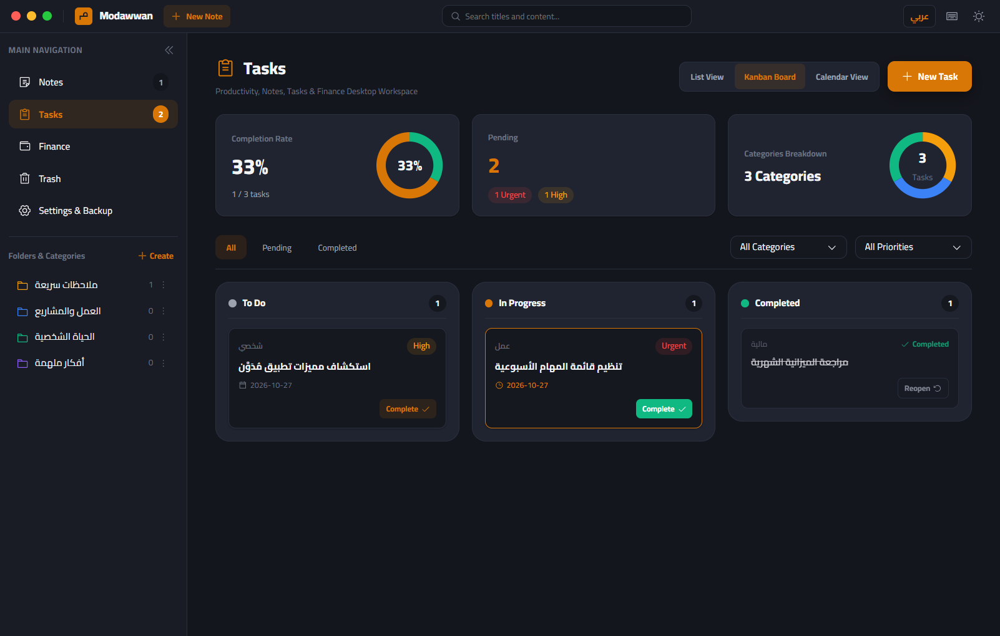
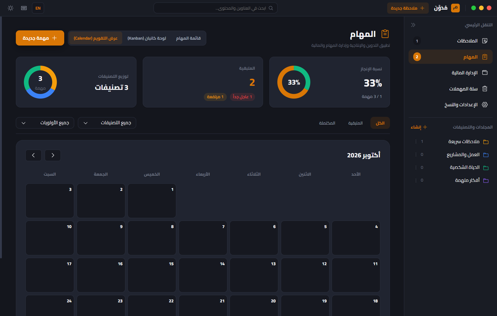
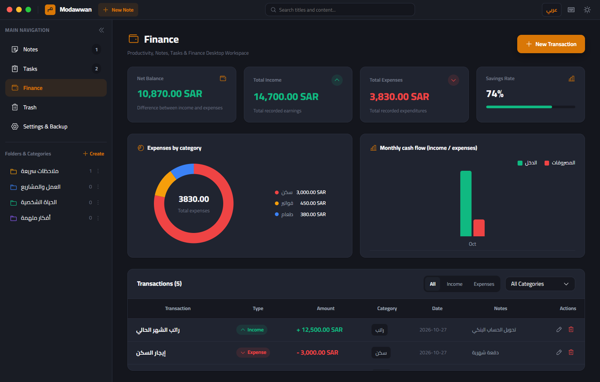
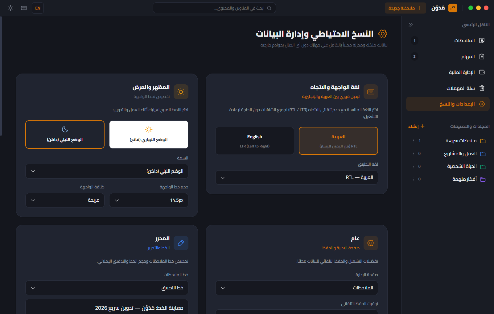

<div dir="rtl" align="right">

<p align="center">
  
</p>

<h1 align="center">مُدَوَّن | Modawwan</h1>

<p align="center">
  <strong>تطبيق مكتبي شخصي مفتوح المصدر لإدارة الملاحظات والمهام والمالية لنظام ويندوز، يعمل محليًا بالكامل ودون اتصال بالإنترنت.</strong><br />
  ملاحظات غنية بالبلوكات والصفحات المتداخلة، مهام كانبان مع عرض التقويم، وتتبع التدفقات المالية، مع دعم أصيل للغتين العربية (RTL) والإنجليزية (LTR).
</p>

<p align="center">
  <a href="https://github.com/husseinezzat0/modawwan/releases/tag/v1.2.0"></a>
  <a href="LICENSE"></a>
  
  
</p>

<p align="center">
  <a href="https://github.com/husseinezzat0/modawwan/releases/latest/download/Modawwan-Setup.exe">
    
  </a>
</p>

<p align="center">
  <sub><b>يدعم ويندوز 10 و 11 (64-بت)</b> • يعمل بدون إنترنت • مجاني ومفتوح المصدر</sub><br />
  <a href="https://github.com/husseinezzat0/modawwan/releases">📦 عرض جميع الإصدارات والنسخة المحمولة</a>
</p>

<p align="center">
  <a href="#-التحميل-والتثبيت">التحميل والتثبيت</a> •
  <a href="#-لقطات-الشاشة">لقطات الشاشة</a> •
  <a href="#-المميزات-الرئيسية">المميزات</a> •
  <a href="#-حزمة-التقنيات">التقنيات</a> •
  <a href="#-بيئة-التطوير">التطوير</a> •
  <a href="#-التحديثات-التلقائية">التحديثات</a> •
  <a href="README.md"><strong>English README</strong></a>
</p>

---

## 📌 نبذة عامة

صُمم **مُدَوَّن** لمنحك السيطرة والخصوصية الكاملة على إنتاجيتك اليومية دون الاعتماد على خوادم سحابية خارجية أو نماذج اشتراك. يعمل التطبيق محلياً كبرنامج سطح مكتب أصيل لنظام ويندوز، وتُحفظ جميع ملاحظاتك ومهامك وسجلاتك المالية في قاعدة بيانات SQLite مدمجة داخل مجلد AppData على جهازك.

لا حسابات، لا تتبع أو تحليلات، ولا اعتماد على اتصال الإنترنت.

---

## 📸 لقطات الشاشة

### محرر الملاحظات والبلوكات المنسقة
| الواجهة العربية — الوضع الداكن (RTL) | الواجهة الإنجليزية — الوضع الفاتح (LTR) |
|:---:|:---:|
|  |  |

### لوحة مهام كانبان وعرض التقويم
| لوحة كانبان التفاعلية | جدولة المهام حسب تواريخ الاستحقاق |
|:---:|:---:|
|  |  |

### الإدارة المالية وإعدادات التطبيق
| تتبع الدخل والمصروفات والرسوم البيانية | التخصيص والخطوط والخيارات العامة |
|:---:|:---:|
|  |  |

---

## ✨ المميزات الرئيسية

- **محرر ملاحظات متقدم** — دعم Markdown وقائمة الشرطة المائلة (`/`) لكتابة العناوين، القوائم، الشفرات البرمجية، الجداول، المقتبسات، وصناديق التنبيه.
- **صفحات متداخلة وروابط داخلية** — شجرة صفحات متعددة المستويات، روابط داخلية سريعة بين الملاحظات، استكشاف الروابط العكسية، وتثبيت الملاحظات الهامة وسلة محذوفات قابلة للاستعادة.
- **إدارة المهام بأسلوب كانبان** — سحب وإفلات بين القوائم (`مهام`، `قيد التنفيذ`، `مكتملة`)، مع أولويات ملونة وتصنيفات وحساب نسبة الإنجاز.
- **جدولة التقويم** — عرض شهري تفاعلي للمهام وتواريخ استحقاقها.
- **إدارة التدفقات المالية** — تسجيل المعاملات وتصنيفها مع رسوم بيانية SVG مدمجة لحساب معدل الادخار وتوزيع النفقات دون الحاجة لأي مكتبات خارجية.
- **قوالب جاهزة** — محاضر اجتماعات، خطط مشاريع، يوميات شخصية، وميزانيات مالية.
- **بحث فوري شامل** — فهرسة SQLite محلية سريعة لجميع الملاحظات والمهام والمعاملات.
- **نسخ احتياطي آمن** — تصدير واستيراد بصيغة JSON مع تدقيق سلامة البنية وإنشاء نسخة استرجاع تلقائية قبل أي استيراد.
- **واجهة ثنائية اللغة** — دعم متكامل للعربية والإنجليزية مع خطوط Cairo وInter المدمجة.

---

## 📥 التحميل والتثبيت

حمّل [**مثبت ويندوز المباشر (Modawwan-Setup.exe)**](https://github.com/husseinezzat0/modawwan/releases/latest/download/Modawwan-Setup.exe) فوراً، أو تصفح كافة الملفات والنسخة المحمولة عبر [صفحة الإصدارات على GitHub](https://github.com/husseinezzat0/modawwan/releases).

- **نسخة التثبيت الرسمية (`Modawwan-Setup.exe`)**:
  - تثبيت سريع لنظام ويندوز مع اختصارات سطح المكتب وقائمة ابدأ.
  - لا يتطلب صلاحيات مسؤول (Administrator).
  - يدعم التحديثات التلقائية المدمجة.
  - إزالة التطبيق لا تحذف قاعدة بياناتك.
- **النسخة المحمولة (`Modawwan-Portable-1.2.0.exe`)**:
  - ملف تشغيلي واحد يعمل مباشرة دون تثبيت.

---

## 💻 متطلبات النظام

- **نظام التشغيل:** ويندوز 10 (إصدار 1809 فما بعده) أو ويندوز 11 (64-بت).
- **الذاكرة العشوائية (RAM):** 2 جيجابايت كحد أدنى (يُفضل 4 جيجابايت).
- **المساحة التخزينية:** حوالي 250 ميجابايت للتطبيق وقاعدة البيانات.
- **الاتصال بالإنترنت:** اختياري تمامًا، ويُستخدم فقط للتحقق من التحديثات وتنزيلها.

---

## 🛠️ حزمة التقنيات

| المكون | التقنية المستخدمة |
|---|---|
| **بيئة التشغيل** | [Electron 45](https://www.electronjs.org/) (معزول وآمن ومحمي) |
| **الواجهة الأمامية** | [React 19](https://react.dev/)، [TypeScript 5.7](https://www.typescriptlang.org/) |
| **مجمع الحزم** | [Vite 6](https://vitejs.dev/) |
| **قاعدة البيانات** | محرك SQLite 3 مدمج بنمط WAL واستعلامات مجهزة |
| **الأيقونات** | [Phosphor Icons](https://phosphoricons.com/) بترخيص MIT |
| **الخطوط** | خط Cairo العربي الحر وخط Inter اللاتيني |
| **التحزيم والتحديث** | electron-builder وelectron-updater |

---

## 🚀 بيئة التطوير

```powershell
# استنساخ المستودع
git clone https://github.com/husseinezzat0/modawwan.git
cd modawwan

# تثبيت الاعتماديات
npm install

# تشغيل بيئة التطوير
npm run dev
```

### الفحص والاختبارات

```powershell
# فحص دقة الأنواع عبر TypeScript
npm run typecheck

# تشغيل اختبارات الأمان وقاعدة البيانات والأيقونات
npm test

# تشغيل فاحص الأسرار والبيانات الحساسة
node test/secrets-scan.cjs
```

---

## 🔄 التحديثات التلقائية وحالة التوقيع الرقمي

- **القناة الرسمية:** تصل التحديثات عبر GitHub Releases الرسمية.
- **اكتشاف التحديثات:** يكتشف التطبيق توفر أي إصدار مستقر جديد تلقائيًا ويعرض سجل التغييرات داخل نافذة الإعدادات.
- **حالة التوقيع الرقمي (قيد التقديم):** التوقيع الرقمي عبر مؤسسة **SignPath Foundation** قيد **التقديم والمراجعة حاليًا ولم يُفعّل بعد**. يتم توزيع إصدار 1.2.0 الأولي كنسخة مجتمعية غير موقعة، ويتم توجيه التثبيت بأمان لتنزيل النسخة يدويًا لحين تفعيل التوقيع المعتمد.
- **تنزيل الفروقات:** تقنية NSIS Blockmap تضمن تنزيل الأجزاء المعدلة فقط لتوفير استهلاك البيانات.
- **حماية التعديلات:** لن يُغلق التطبيق أو يُعاد تشغيله فجأة أثناء كتابتك؛ تُحفظ الملاحظات المعلقة في قاعدة البيانات قبل تطبيق أي تحديث.
- **تحكم كامل:** يمكن إيقاف التحقق التلقائي في أي وقت من **الإعدادات ← التحديثات**.

---

## 🔒 أمان وخصوصية البيانات والسياسات

- **التخزين المحلي:** تحفظ كافة السجلات في المسار التالي:
  ```text
  %APPDATA%\Modawwan\modawwan_notes.sqlite
  ```
- **انعدام التتبع:** لا توجد إحصائيات، لا تتبع استخدام، ولا اتصالات مخفية بالإنترنت.
- **السياسات الموثقة:**
  - 🛡️ [سياسة الخصوصية (Privacy Policy)](docs/PRIVACY_POLICY.md) — توثيق شامل للتخزين المحلي واتصالات التحديثات.
  - ✍️ [سياسة التوقيع الرقمي (Code Signing Policy)](docs/CODE_SIGNING_POLICY.md) — معايير الأمان ومسار البناء والتحقق المعتمد.
  - 🔒 [سياسة الأمان (Security Policy)](SECURITY.md) — الإبلاغ عن الثغرات ومعايير العزل.
- **حماية النواة:**
  - واجهة المستخدم معزولة في بيئة Sandbox.
  - تعطيل `nodeIntegration` وتفعيل `contextIsolation`.
  - تطبيق سياسة أمان محتوى صارمة (CSP).
  - التحقق الصارم من كل أمر يمر عبر IPC.

---

## 📄 الترخيص

المشروع مرخص بموجب **رخصة MIT** — انظر ملف [LICENSE](LICENSE) لمزيد من التفاصيل.  
تراخيص وإشعارات حزم الطرف الثالث مفصلة في [THIRD_PARTY_NOTICES.md](THIRD_PARTY_NOTICES.md).

---

## 👤 المطور والمسؤول عن المشروع

**تم التطوير والإدارة بواسطة: حسين عزت (Hussein Ezzat)**  
الموقع الشخصي: [husseinezzat.com](https://www.husseinezzat.com) • حساب GitHub: [@husseinezzat0](https://github.com/husseinezzat0)

*جميع الحقوق محفوظة © 2026 حسين عزت.*

</div>
