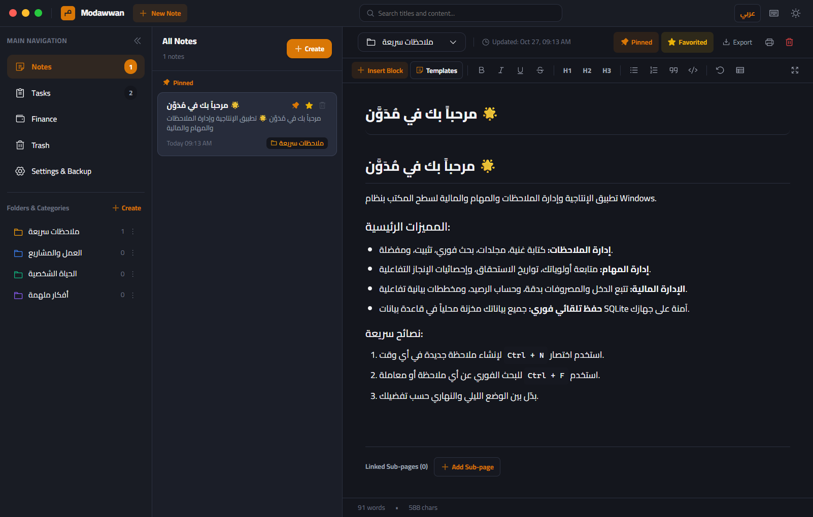

<div dir="ltr">

# Modawwan | مُدَوَّن

**Personal productivity suite for Windows — notes, tasks, finance. Local-first, private, and fast.**

*A full Arabic documentation section is included below — وثائق عربية كاملة في الأسفل.*

Modawwan (Arabic: مُدَوَّن, "the chronicler") is an offline-first desktop productivity app for
Windows that keeps **notes with rich text and blocks, nested pages, internal links, tasks with a
Kanban board and calendar, personal finance with charts** — all stored locally in SQLite.

| | |
| --- | --- |
| **Platform** | Windows 10/11 x64 |
| **Data location** | `%APPDATA%\Modawwan\modawwan_notes.sqlite` (local only) |
| **License** | MIT © 2026 Hussein Ezzat |
| **Developer** | Hussein Ezzat — حسين عزت |

<!--
Real screenshots of the running app (generated from the packaged build):
replace/update these files when the UI evolves.
-->
| Notes Editor | Tasks & Kanban | Finance |
| --- | --- | --- |
|  |  |  |

## ✨ Features

- **Notes** — rich-text editor, block editor with slash commands (`/`), headings, lists, quotes,
  code blocks, tables, callouts, and checkboxes.
- **Nested pages & internal links** — organize notes into parent/child pages, link between pages
  with internal note links, backlinks panel, pinned/favorite notes, trash with restore.
- **Tasks** — Kanban board (To Do / In Progress / Completed), priorities, categories, due dates,
  completion stats with progress charts.
- **Calendar view** — month grid of tasks with due dates and day selection.
- **Finance management** — income/expense transactions, categories, monthly cash-flow charts and
  expense breakdowns (custom SVG charts, offline).
- **Templates** — ready-made note templates (meeting minutes, project roadmap, daily journal,
  budget planning) in Arabic and English.
- **Search & filters** — full-text search across notes, tasks, and transactions with filters.
- **Backup & restore** — one-click JSON backup export/import with integrity validation and an
  automatic local recovery copy before any restore.
- **Settings** — theme (light/dark/system), language, start view, editor font/size, density,
  spellcheck, keyboard shortcuts reference.
- **Arabic/English + RTL/LTR** — full interface translation with correct bidirectional layout,
  right-to-left aware menus and dropdowns.
- Local-only SQLite persistence, auto-save debounce, and window-state memory.

## 🖥️ Windows Requirements

- Windows 10 (1809+) or Windows 11, x64.
- No admin rights needed — installation to a user directory is supported.
- Core note, task, and finance features work offline. Internet is used only when checking for or downloading updates.

## 📦 Installation (End Users)

Download the Windows installer from the [GitHub Releases page](https://github.com/husseinezzat0/modawwan/releases).

- NSIS installer: per-user install, optional install directory, desktop + start-menu
  shortcuts, uninstaller leaves your data intact.
- Portable build: run one EXE, no installation.

**Your data is never part of the installation** — uninstalling Modawwan does **not** delete
`%APPDATA%\Modawwan` (SQLite database + preferences). Delete that folder manually if you want a
full wipe.

## 🛠️ Development Setup

```powershell
git clone https://github.com/husseinezzat0/modawwan.git
cd modawwan
npm install
npm run dev         # Vite dev server + Electron
```

- `npm run typecheck` — TypeScript strict check.
- `npm test` — security IPC tests, DB verification, and icon-governance tests.
- `npm run dev:web` — renderer only in a browser (no Electron main).

Local development needs no credentials. Release publishing uses the GitHub Actions token; optional Windows signing credentials are stored only as repository secrets.


> Users on version **1.1.0 or earlier** must install version 1.2.0 manually once. NSIS updates require a trusted signing publisher and a validated update channel. Portable builds only link to the release page and must be replaced manually.
## 🔨 Build Instructions

```powershell
npm run build:win   # regenerate icon set + vite build + electron-builder (NSIS + portable)
```

Output lands in `release/`:
- `Modawwan-Setup-<version>.exe` (NSIS installer)
- `Modawwan-Portable-<version>.exe`

CI runs the same steps on GitHub Actions (Windows runner): install → typecheck → tests →
production build → packaging verification. Stable releases are built only by manually dispatching the release workflow on an approved version tag after all checks pass. See `.github/workflows/ci.yml` and `.github/workflows/release.yml`.

## 🧰 Used Technologies

- **Electron 45** (main/preload IPC with context isolation + sandbox)
- **React 19 + TypeScript 5.7**, built with **Vite 6**
- **better-sqlite3-style native persistence** via the bundled SQLite layer in
  `src/main/db.cjs` (prepared statements, WAL, migrations)
- Custom design system components (accessible custom dropdowns, dialogs)
- Icon set: Phosphor Icons for React (MIT), mapped through src/components/common/iconsMap.ts.

## 🔐 Local Data Storage & Security/Privacy

- All data stays in `%APPDATA%\Modawwan\` — SQLite database + window prefs. No server, no
  analytics, no crash reporting, no account. Update checks contact GitHub Releases only when enabled.
- Electron hardened by default: `contextIsolation: true`, `sandbox: true`,
  `nodeIntegration: false`, strict CSP (`script-src 'self'`, no eval, no remote origins),
  all permissions denied, external navigation never allowed inside the app window.
- Every IPC channel validates sender identity and argument shape/size in the main process
  (`src/main/validation.cjs`) — no renderer-supplied SQL fragments: all statements are
  prepared with typed parameters.
- Backup files are validated (schema, sizes, referential integrity, settings allowlist)
  before import; import requires explicit user confirmation and creates a local recovery
  backup first.
- Known limitations: backups are plain JSON (store them safely); the app is not code-signed
  yet, so Windows SmartScreen may warn on first launch of the installer.

## 📄 License

Code: [MIT](LICENSE) © 2026 Hussein Ezzat.
Third-party packages and the icon-library status are documented in
[THIRD_PARTY_NOTICES.md](THIRD_PARTY_NOTICES.md).

## 👤 Developer Credits

**Modawwan** is designed and developed by **Hussein Ezzat (حسين عزت)**.

---

</div>

<div dir="rtl" align="right">

# مُدَوَّن | Modawwan

**حزمة إنتاجية شخصية لنظام Windows — ملاحظات، مهام، وإدارة مالية. تعمل محليًا بالكامل، خاصة وسريعة.**

مُدَوَّن (Modawwan) هو تطبيق سطح مكتب يعمل دون اتصال بنظام Windows يجمع بين:

| | |
| --- | --- |
| **النظام** | ويندوز 10/11 x64 |
| **موقع البيانات** | `%APPDATA%\Modawwan\modawwan_notes.sqlite` (محلي فقط) |
| **الترخيص** | MIT © 2026 حسين عزت |
| **المطور** | حسين عزت — Hussein Ezzat |

## ✨ أبرز المميزات

- **ملاحظات** — محرر نصوص منسق، محرر بكتات مع أوامر الشرطة المائلة، عناوين وقوائم واقتباسات
  وشفرات وجداول وصناديق تنبيه.
- **صفحات متداخلة وروابط داخلية** — تنظيم الملاحظات كصفحات أصل/فرعية، روابط بين الصفحات، لوحة
  الربط العكسي، تثبيت الملاحظات، وسلة محذوفات مع الاستعادة.
- **مهام** — لوحة كانبان (مهام/قيد التنفيذ/مكتملة)، أولويات، تصنيفات، تواريخ استحقاق، ورسوم
  إحصائية للتقدم.
- **عرض التقويم** — شبكة شهرية للمهام مع التواريخ واختيار اليوم.
- **إدارة مالية** — معاملات دخل/مصروف، تصنيفات، مخططات تدفق نقدي شهري وتفصيل للمصروفات.
- **قوالب جاهزة** — محضر اجتماع، ميثاق مشروع، يوميات، وخطة مالية — بالعربية والإنجليزية.
- **بحث وتصفية** — بحث شامل في الملاحظات والمهام والمعاملات.
- **نسخ احتياطي واستعادة** — تصدير/استيراد JSON مع تحقق من السلامة ونسخة استرجاع محلية قبل أي
  استبدال للبيانات.
- **الإعدادات** — وضع الفاتح/الداكن، اللغة، واجهة البداية، خط المحرر وحجمه، الكثافة، التدقيق
  الإملائي، ومرجع اختصارات لوحة المفاتيح.
- **عربي/إنجليزي مع RTL/LTR** — ترجمة كاملة للواجهة بتنسيق ثنائي الاتجاه صحيح.
- تخزين SQLite محلي بالكامل مع حفظ تلقائي، بلا حساب ولا تحليلات ولا اتصال إنترنت.

## 🖥️ متطلبات التشغيل

- ويندوز 10 (1809+) أو ويندوز 11 بنية x64.
- لا يحتاج صلاحيات مدير — يمكن التثبيت في مجلد المستخدم.
- تعمل الميزات الأساسية دون اتصال؛ يستخدم فحص التحديثات وتنزيلها الإنترنت.

## 📦 التثبيت (للمستخدمين)

حمّل أحدث مثبّت ويندوز من صفحة [الإصدارات على GitHub](https://github.com/husseinezzat0/modawwan/releases).

**بياناتك ليست جزءًا من التثبيت** — إزالة تثبيت مُدَوَّن **لا تحذف** مجلد
`%APPDATA%\Modawwan` (قاعدة البيانات والإعدادات). احذف المجلد يدويًا فقط إن أردت الإزالة الكاملة.

## 🛠️ إعداد التطوير

```powershell
git clone https://github.com/husseinezzat0/modawwan.git
cd modawwan
npm install
npm run dev
```

- `npm run typecheck` — تحقق TypeScript.
- `npm test` — اختبارات أمان IPC وقاعدة البيانات وحوكمة الأيقونات.
- لا تحتاج بيئة التطوير المحلية إلى بيانات اعتماد. النشر يستخدم GitHub Actions token، وشهادة توقيع Windows اختيارية ومخزنة في GitHub Secrets.

## 🔨 بناء حزمة النشر

```powershell
npm run build:win   # توليد الأيقونات + بناء Vite + تجميع electron-builder
```

المخرجات في `release/` (مثبّت NSIS + نسخة محمولة).

## 🔐 الخصوصية وحماية البيانات

- كل البيانات في `%APPDATA%\Modawwan` محليًا — بلا حساب، بلا تحليلات، بلا اتصال.
- سياسة أمان Electron صارمة (عزل، حماية، تحقق من المرسل والوسائط، CSP صارمة، منع تنقل خارجي).
- ملفات النسخ الاحتياطي تُدقق قبل الاستيراد وتتطلب تأكيد صريحًا، مع نسخة استرجاع محلية تلقائية.
- القيود المعروفة: النسخ الاحتياطي ملف JSON عادي (احفظه بأمان)، والتطبيق غير موقّع رقميًا بعد —
  لذا قد تظهر نافذة SmartScreen عند أول تشغيل للمثبّت.

## 📄 الرخصة

الكود: [MIT](LICENSE) © 2026 حسين عزت. تفاصيل حزم الطرف الثالث في
[THIRD_PARTY_NOTICES.md](THIRD_PARTY_NOTICES.md).

## 👤 المطور


</div>
